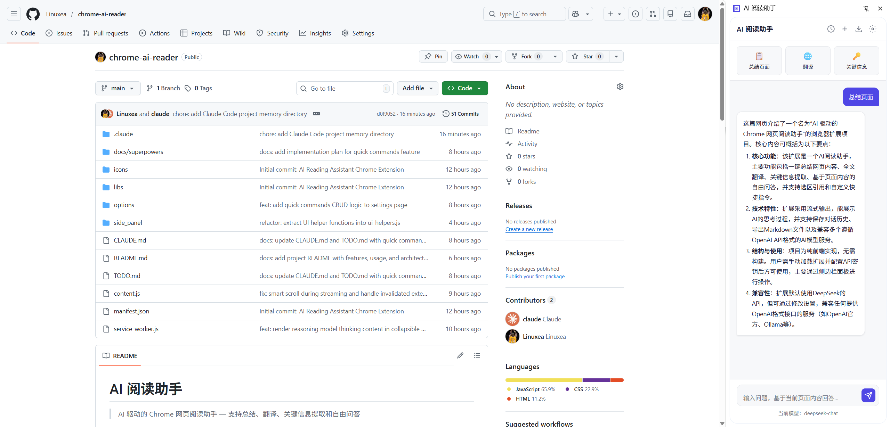

# 小🍐子阅读助手

> 贴身的 AI 网页阅读伙伴 — 让任何网页都能被读懂、被追问、被收藏



打开任意网页，点一下扩展图标（或按 `Alt+S`），小🍐子就会出现在侧边栏里陪你读：总结全文、翻译外文、提取要点、回答追问；PDF 和 YouTube 视频也能读；答案里的每句话都能一键跳回原文出处；读到一半可以划线记笔记，读完了还能让它出题考你、或者把整篇变成一档双人播客。

## 亮点

- **零摩擦** — 不用复制粘贴，打开网页就能问；每个标签页各有一份独立会话
- **双通道接入** — 兼容所有 OpenAI 协议服务（DeepSeek / OpenAI / Ollama / vLLM…），也原生支持 Anthropic Claude
- **有据可循** — 回答标注 `[#N]` 引用，点击即定位原文并高亮；YouTube 直接跳到对应时间点
- **不只是聊天** — 大纲、测验、对照翻译、深度批阅、高亮笔记、播客、朗读，每种阅读姿势都有
- **中英双语 + 三种主题** — 界面随你心情换装

## 功能一览

### 阅读助手
- **一键总结 / 全文翻译 / 关键信息提取** — 针对整页或选中区域
- **自由问答** — 基于当前页面内容的多轮对话，支持消息重试、编辑与分支
- **推理过程** — 可折叠展示推理模型的思考链路
- **智能体模式**（可选开关）— AI 可以调用只读工具（检索页面段落、读取选区、打开标签页、在页面高亮）分步完成任务

### 深度阅读
- **大纲生成** — 结构化大纲树，节点可展开摘要与原文引用，支持导出
- **深度批阅** — 对页面关键句子自动生成三类标注：**批判**（指出论点风险）、**反方**（给出对立观点）、**漏洞**（挑逻辑毛病），可一键带入对话继续追问
- **测验** — 根据页面内容出题，读完测一测
- **对照翻译** — 在页面内开启沉浸式双语翻译，原文译文逐段对照

### 页面理解
- **PDF 阅读** — 直接解析 PDF 原文（不依赖网页正文提取）
- **YouTube 字幕** — 抓取视频字幕作为上下文，按时间戳提问
- **引用溯源** — 回答中的 `[#N]` 引用芯片可点击定位：网页滚动高亮、YouTube 跳转进度、PDF 弹出原文
- **选区引用** — 选中文字自动捕获为对话上下文

### 高亮与笔记
- **页面划线高亮** — 选中后 🖍 一键高亮（或走右键菜单），重进页面自动重现
- **笔记管理** — 在高亮上追加笔记、就某条笔记继续追问、一键导出全部笔记为 Markdown

### 输入与回放
- **看图说话** — 上传 / 粘贴 / 拖拽图片直接交给多模态模型（无需单独的 OCR 服务）
- **流式输出** — 实时显示 AI 回复，长答案不再干等
- **TTS 语音朗读** — 火山引擎语音，支持自动接龙、倍速、单条回复下载；已听过的段落自动缓存，重播零等待
- **播客生成** — 把网页变成两位主持人对话形式的音频，支持播放控制与同步字幕，可下载
- **快捷指令** — 输入 `/` 召唤自定义指令，支持键盘上下选择

### 记忆与管理
- **对话历史** — 最近 300 条对话自动保存，可回看、继续、删除
- **导出 Markdown** — 单条对话或全部笔记一键导出
- **用量统计** — 设置页查看 API 调用消耗
- **设置导入/导出** — 一键备份所有配置（密钥默认不导出），换机无忧

### 外观
- **三种主题** — 素笺（暖棕）、海洋（冷蓝）、森林（自然绿）
- **深色模式** — 一键切换日夜
- **中英双语** — 界面语言实时切换

## 安装

1. 在 Chrome 浏览器访问 `chrome://extensions/`
2. 打开右上角的 **开发者模式**
3. 点击 **加载已解压的扩展程序**，选择项目的 `dist/` 目录（想自己构建见下方[开发](#开发)）
4. 工具栏会出现小🍐子图标，点击或在任意网页按 `Alt+S` 打开侧边栏

## 配置

点侧边栏右上角的齿轮进入设置页。

### 必填（否则功能不可用）
- **供应商** — OpenAI 兼容协议 或 Anthropic 原生协议
- **API Key** — 对应服务的密钥
- **API 地址** — 默认 `https://api.deepseek.com`，可换成 OpenAI、Ollama、自建 vLLM 等；Anthropic 协议默认官方地址
- **模型名称** — 默认 `deepseek-chat`，可点刷新按钮自动拉取可用模型列表

### 可选增强
| 功能 | 需要配置 | 解锁的能力 |
|------|---------|-----------|
| **引用溯源** | 开关（默认开） | 回答中的 `[#N]` 可点击定位原文 |
| **智能体模式** | 开关 | AI 分步调用只读工具完成任务 |
| **TTS 语音朗读** | 火山引擎 TTS 凭证 | 朗读回复、自动接龙、倍速、下载 |
| **播客生成** | 火山引擎 TTS 凭证（+本地代理） | 网页→双人对话音频 |
| **推荐追问** | 开关 | AI 回复后自动建议 3 个追问 |
| **自定义 System Prompt** | 填入个性化提示词 | 调整 AI 回答风格 |
| **快捷指令** | 在设置页增删 | 输入 `/` 快速调用 |

> **播客功能**默认需要本地代理服务器（浏览器直连火山引擎播客 WebSocket 受限）：进入 `proxy/` 目录执行 `npm install && npm start`，代理会在 `127.0.0.1:3456` 启动（仅监听本机，只接受来自本扩展的浏览器请求）。也可以在设置中开启 **直连模式** 跳过代理，连接失败时会自动回退。

## 使用

| 想做什么 | 怎么做 |
|---------|--------|
| 打开 / 唤出小🍐子 | 点击扩展图标，或按 `Alt+S` |
| 就选中内容提问 | 选中文字后按 `Alt+Q`，或右键「就此提问」 |
| 总结当前页 | 点击侧边栏 **总结** 按钮，或右键「总结这个页面」 |
| 翻译当前页 | 点击 **翻译** 按钮 |
| 提取要点 | 点击 **关键信息** 按钮 |
| 解释选中内容 | 选中后点击 **解释**，或右键「解释选中内容」 |
| 深度批阅 | 点击 **深度批阅** 按钮，等待标注出现 |
| 随堂测验 | 点击 **测验** 按钮 |
| 沉浸式对照翻译 | 点击 **对照翻译** 按钮，或右键开关 |
| 生成播客 | 点击 **播客** 按钮 |
| 划线记笔记 | 选中文字 → 🖍 高亮；笔记面板查看 / 追问 / 导出 |
| 召唤快捷指令 | 输入 `/`，上下键选择 |
| 重抽回复 | 点用户消息上的刷新按钮 |
| 朗读回复 | 点 AI 消息上的播放按钮 |
| 查看历史 | 点右上角时钟图标 |
| 切主题/语言 | 进入设置页 |

## 兼容性

- Chrome / Edge / 其他 Chromium 内核浏览器（需支持 Manifest V3 与 Side Panel）
- 兼容所有 OpenAI 协议的 LLM 服务端点，或 Anthropic 官方协议

## 开发

```bash
npm install        # 安装依赖
cd proxy && npm install   # 播客代理依赖（不测播客可跳过）
npm run dev        # 开发构建（watch 模式，改完即生效）
npm run build      # 生产构建，产物在 dist/
npm test           # 运行测试
```

加载 `dist/` 目录即可调试。架构说明、约定与注意事项见 [AGENTS.md](AGENTS.md)。

## 反馈

遇到问题或有想法？欢迎在仓库提 issue。

## 许可证

MIT
